# Reader designs: A, B and C compared

Three readers for the same manual (*The Haunt That Listens*), built under the same rules in
`DESIGN_RULES.md`. All three pass every locked rule after the fix round. The difference is
character and how each one spends the screen. Screenshots were taken after the fixes, at 1440×900
(desktop) and 375×812 (phone). All 18 states per design are in `docs/comparison/<a|b|c>/`.

## 1. At a glance

| | Concept | Palette | Type | Navigation | Signature moment | Technique |
| --- | --- | --- | --- | --- | --- | --- |
| **A: Dense reference** | A show-control desk: engineering docs in three columns | Graphite, cool off-white, one “GO” green that means *live* or *clickable* | IBM Plex Sans 17px, Plex Mono for readouts | Whole index always on the left, “On this page” and “Referenced here” on the right; phone: header button opens a sheet | **Write head**: a green bar beside the paragraph being written, a progress meter in the head rule, a “Being written · 50% · Follow” line | CSS only |
| **B: The book** | A rubricated book read by lamplight | Umber-black paper, parchment ink, one vermilion for numbers and state | Newsreader serif 20px, Plex Mono for code | Title page is the contents; fore-edge tick index on the left; contents sheet one click away; phone: folio bar | **Wet ink**: a red rule draws down the margin with a pen nib at the live line, dries when done, and ends in a drawn tailpiece | CSS + SVG |
| **C: Focused reader** | A dark house with one lamp burning; the text owns the screen | Blue-black night, pale ink, amber for *writing*, gold for *written* | Literata serif 21px, Instrument Sans for interface, JetBrains Mono | Corner “Contents” opens a drawer; phone: bottom bar with ‹ › and a sheet | **The lit house**: a 3D townhouse on the start page whose lit windows are written sections; plus a “developing” fade on the newest words | CSS + WebGL (Three.js) |

## 2. Side by side

Click any image for full size. Full-page captures show fixed bars (B’s folio bar, C’s bottom bar)
in the middle of the page. That is how the capture tool works, not a bug.

| State | A | B | C |
| --- | --- | --- | --- |
| **Start (desktop).** A gives you a dense index three times over. B gives you a title page and a dotted contents list. C puts the house beside the contents. | 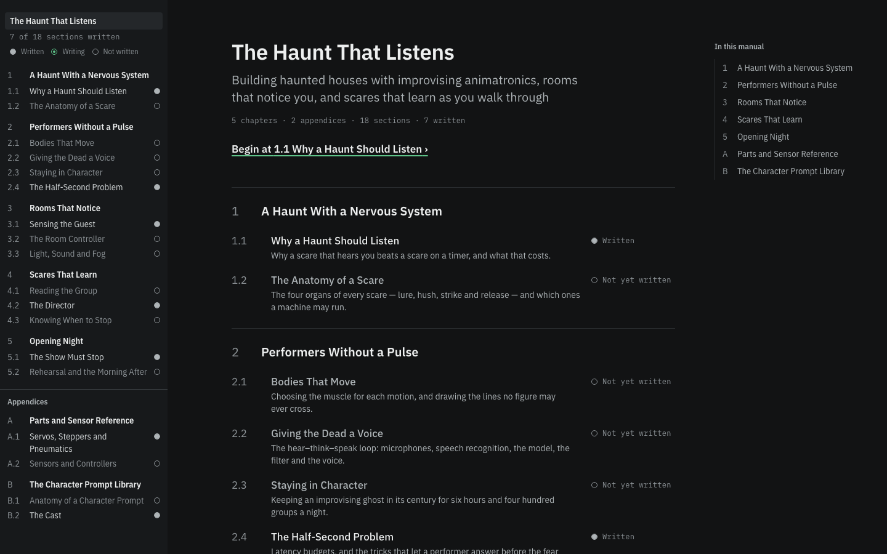 | 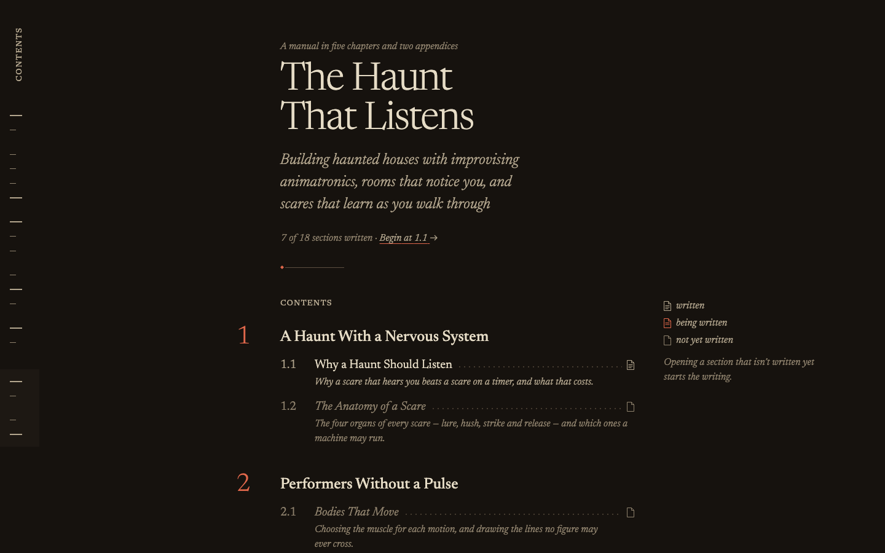 | 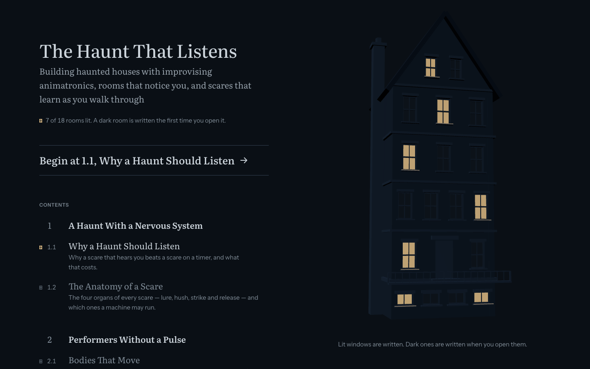 |
| **Dense section 2.4 (desktop).** Look at what fills the width. A uses it for navigation, B for margin headings, sidenotes and wide tables, and C mostly leaves it empty. | 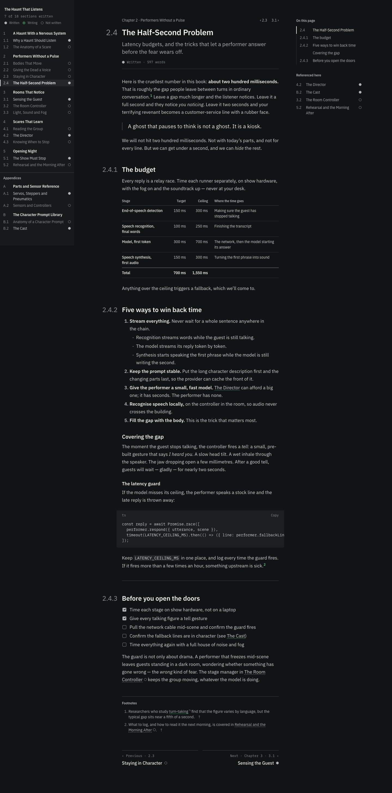 | 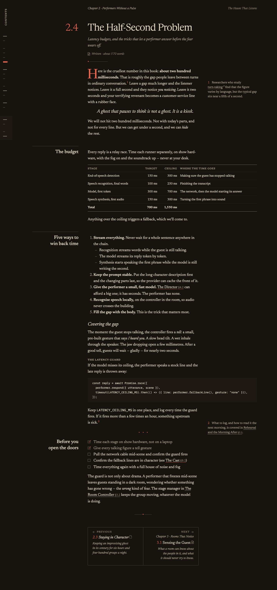 | 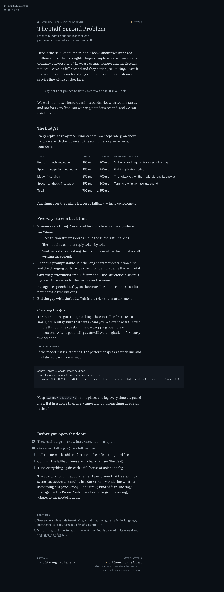 |
| **Streaming at 50% (desktop, full page).** A shows a green bar and a percentage line under the live text. B draws a red ink line down the margin to a nib. C fades the last line and a half. | 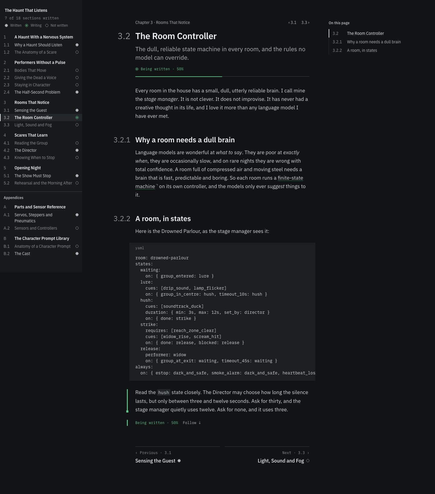 | 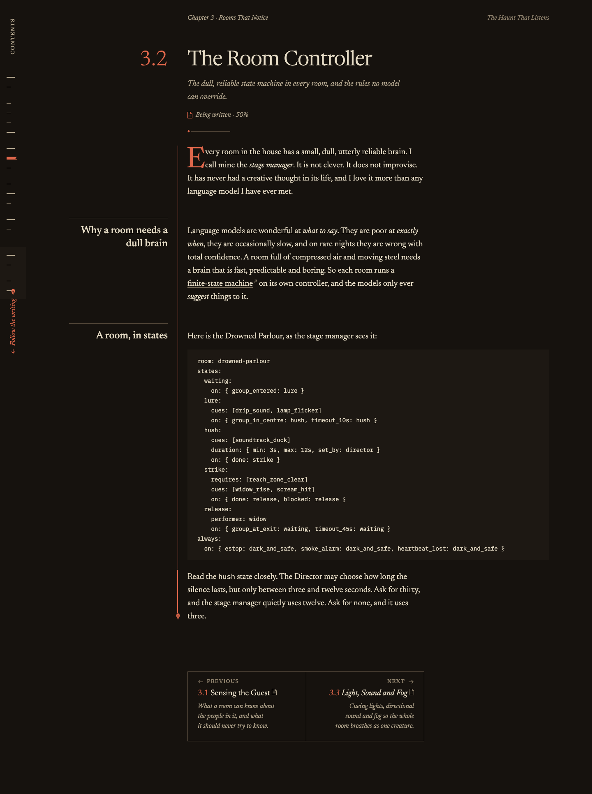 | 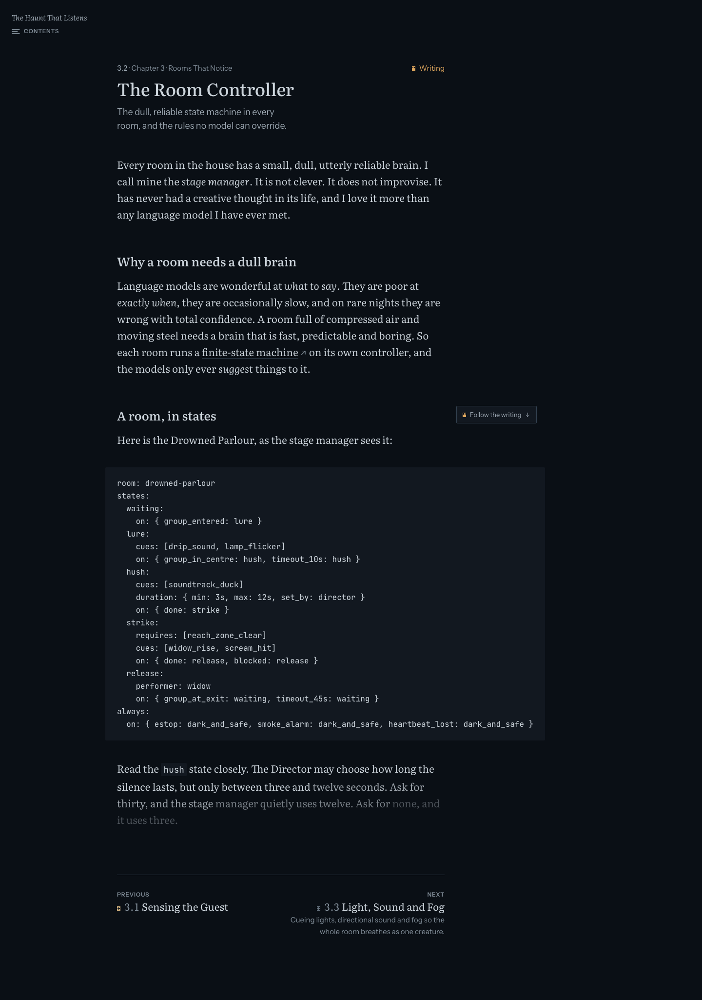 |
| **Contents (phone).** A’s sheet shows the current section’s outline inline. B marks your place with a red ribbon. C uses window glyphs and shows the summary on the current row. | 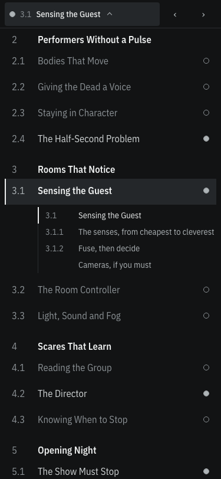 | 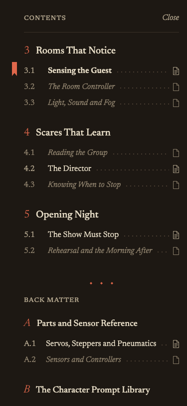 | 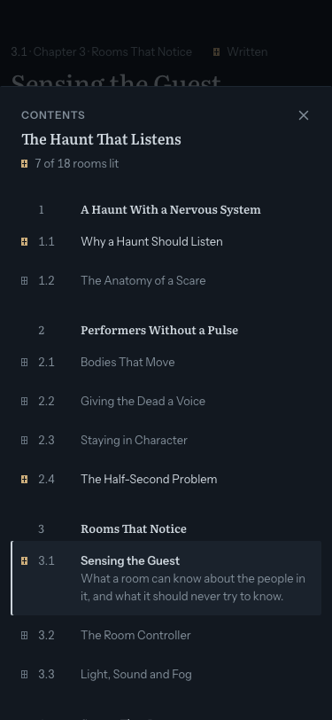 |
| **Appendix A.1 (desktop).** Only B makes the back matter feel different, with catalogue rules, tighter text and full-width tables. A and C set it like a chapter. | 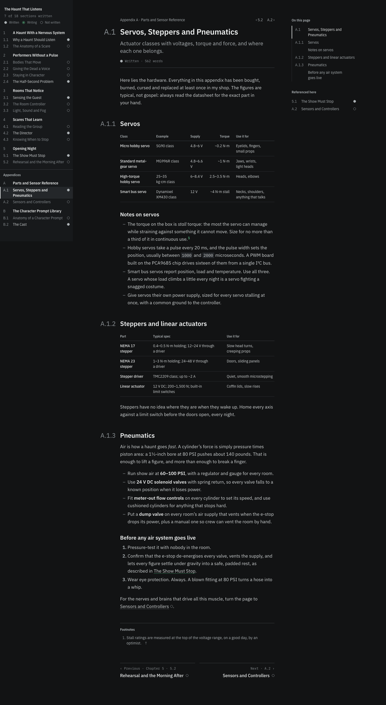 | 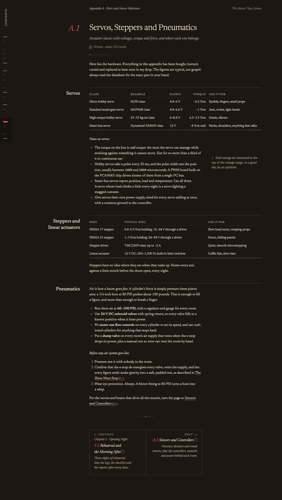 | 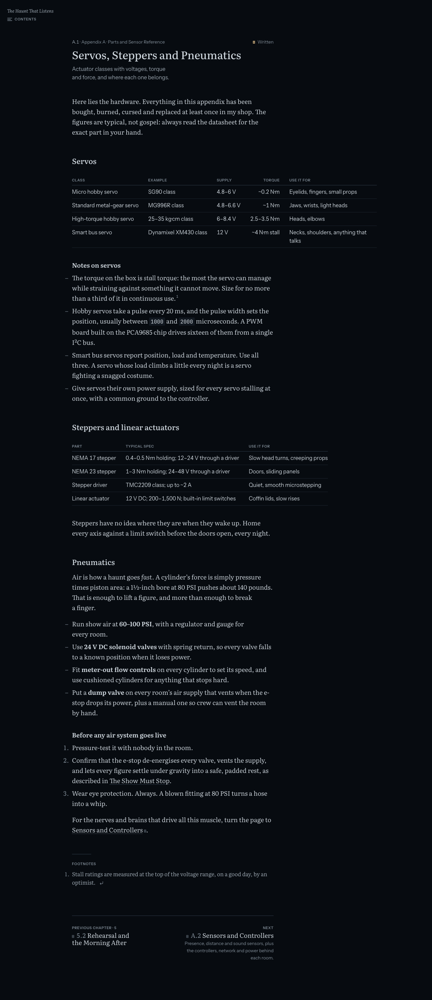 |

## 3. Each design

Review scores are from the independent reviews, taken **before the fix round**. Average across
eight areas: A 3.9, B 3.9, C 3.5.

**A: Dense reference (before fixes: hierarchy 4, reading 5, streaming 3, signature 3, ship 4).**
A is the most precise and the most useful for *looking things up*. The whole manual and each
section’s state are always visible: hollow, half and solid rings in the left index, and the index
now fits at 1440×900 with B.2 showing (`toc-desktop`). Tables are the cleanest of the three, and
the hanging `3.1.1` clause numbers make sections citable. The fix round made the write head
readable. In `streaming-full-desktop` a green bar sits beside the live paragraph, the head rule is
half filled, and “Being written · 50% · Follow ↓” sits directly under the text, with no empty
footnote block in between. Its weakness is personality. At a glance it is a very good docs site,
and the start page lists the chapters three times (`start-desktop`). Code lines are still cut
flush at the right edge in the captures (`performer.fallbackLin…`). The scrollbar that fixes this
only shows in a real browser. On the phone, the header’s ‹ › arrows are faint grey glyphs that are
easy to miss.

**B: The book (before fixes: every area 4 except signature 3; one minor rule failure).**
B has the most craft and is the only design that uses the wide desktop for the *content* rather
than the interface. H2s hang in a left margin column, footnotes sit beside their paragraph as
sidenotes, and tables and code widen into the right margin (`dense-desktop`). The fix round turned
the signature from a grey divider into real ink. In `streaming-desktop` a vermilion rule runs from
the drop cap down to the nib at the live line, and “Follow the writing” on the spine is now red
too. The appendix hierarchy was fixed, and back matter now really looks like the back of a book.
Weaknesses: the desktop contents list is behind a click, and the fore-edge ticks are an abstract
map with no labels until you hover. The prev/next boxes are heavy, with titles wrapping to four or
five lines (“2.4 The Half- / Second Problem” in `written-desktop`). Phone tables still wrap their
first column into three lines (`dense-mobile`). An all-serif interface with an orange-red accent
is a taste some people won’t share.

**C: Focused reader (before fixes: hierarchy 4, reading 4, state clarity 3, phone 3, signature 3,
ship 3; two rule failures).**
C has the most comfortable sentence-level reading: Literata at 21px, about 66 characters a line,
and almost nothing else on screen (`written-desktop`). The house is the most memorable first
screen of the three, and after the fixes its lit windows, sills and hover read clearly
(`start-desktop`). The “developing” tail is now about one line at 1440 and looks like Claude’s own
streaming (`streaming-full-desktop`). Weaknesses: on a 1440 screen roughly the right 40% is empty
unless a preview is open, so the desktop feels underused next to B. State relies on 7×9px window
glyphs, which are still tiny in the drawer (`toc-desktop`). The phone fix for line length (tighter
tracking, 12px gutters) brought back heavy hyphenation, with three breaks in four lines (“con- /
versation”, “lis- / tener”, “no- / tice” in `dense-mobile`). The appendix looks like a chapter.
Most of all, the house only works because *this* manual is about a haunted house. A manual about
bread or tax law would need a different picture.

## 4. What each technique was worth

| | Cost here | What it bought |
| --- | --- | --- |
| **CSS only (A)** | 19 kB JS. Reduced motion is just “all durations to 0s”. | Everything the rules require: state rings, a progress meter, a write head, a hover preview. The fix round showed the signature only needed to be *bolder* (3px instead of 2px), not a different technique. |
| **SVG (B)** | 19 kB JS. About 100 lines of drawings (`drawings.tsx`). Some pixel offsets needed tokenising. | The design’s whole character: leaf glyphs for state, the nib, dot leaders, the ribbon, ornaments and the wet-ink stroke. It stays crisp at any zoom and is cheap to animate with `stroke-dashoffset`. Clearly worth it. |
| **WebGL (C)** | A 146 kB gzipped Three.js chunk (574 kB minified), loaded only on `/c`. About 700 lines in `house/`. It needed `aria-hidden` plus an HTML mirror, a paused loop when offscreen or idle, and a still frame for reduced motion. | One striking start page. It does nothing while you read, and its image is specific to this manual. |

**Verdict:** CSS is enough for the reading surface. SVG was the best return on effort: it gives
personality for almost no cost and no accessibility risk. WebGL was well executed (the loop
discipline is exemplary), but it is not worth it as a foundation. It is on screen for seconds per
visit and can’t adapt to a manual about anything else. A 2D SVG “map of what’s written” would
deliver most of its value.

## 5. Recommendation

**Pick B as the base.** It is the only design that turns the wide desktop into a better *page*
(margin headings, sidenotes, wide tables) rather than more chrome or empty space. Its streaming
signature is the easiest to see in a still frame. And its “book” metaphor fits any manual, not only
this one. With A’s fixes applied it ties A on review scores, and it has far more identity. What
you’d lose: A’s always-visible whole-manual index and its density for jumping around, and C’s calm
and its large, quiet type. B is busier on the page than C and slower to scan than A.

- **Who would prefer A:** someone who uses manuals as reference, jumping to a torque figure and
  back, and wants every section’s state in view at once. Engineers and power users.
- **Who would prefer C:** someone who reads a section start to finish and wants nothing but the
  text, or who values a striking first impression over everyday density.

## 6. Round 2 ideas

1. A’s persistent left index (rings, “7 of 18 written”, legend) in B at ≥1440, in place of the unlabelled fore-edge ticks.
2. A’s progress meter in B’s drawn head rule, so the rule under the summary fills as the section is written.
3. C’s one-line “developing” fade on B’s newest words, alongside the nib, to make B’s streaming feel less mechanical.
4. A’s “Referenced here” backlinks in B’s right margin, wherever no sidenote is using it.
5. A’s numbered clauses (`3.1.1`) on B’s hung margin headings, so text can cite sub-sections.
6. C’s phone bottom bar (section title, ‹ ›) for B’s phone folio bar, which has no prev/next today.
7. C’s start-page split (contents on the left, a picture of what’s written on the right), redrawn in SVG as something generic, such as a shelf of chapter spines that fill with ink.
8. A’s slimmer prev/next pager (title and state glyph only) instead of B’s tall boxed cells.

## 7. How to see it live

1. Run `npm run dev`, then open http://localhost:5173/a (or `/b`, `/c`).
2. The A | B | C tab on the right edge switches designs and keeps the section you’re on.
3. To watch a section being written, open an unwritten one (a hollow ring in A, a blank leaf in B,
   a dark window in C).
4. Reload the page to reset the manual and watch it again.
